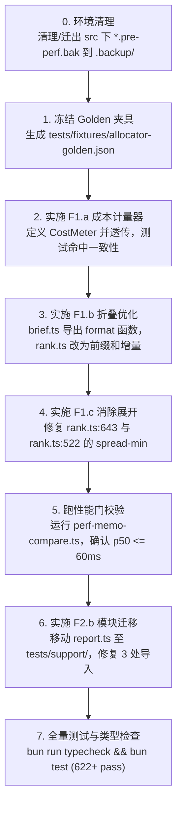

# 评审报告：简报分配器热路径与测试专用代码落位计划

- **被审文档**：`docs/plans/PERF_FIX_ALLOCATOR_AND_TEST_PROBES.md`
- **审阅日期**：2026-10-28
- **审阅结论**：**有条件批准（Conditional Approval）**。性能诊断真实可靠，F1 核心优化收益明确，等价性保障思路严密；但在 **npm 打包污染**、**F2.a 运行时异常风险**、**F1.c 遗漏的 spread 展开点** 以及 **F1.b 模板解耦** 等关键细节上必须在实施前进行修正与剪枝。

---

## 1. 总体评审结论与执行建议

该计划针对 0.1.3 版本发布后发现的“codemode 路径分配器性能抖动”与“`src/` 内部混入测试代码”两类问题进行了详实的实测分析。经在当前工作区（HEAD `a59fdad`，622 pass）独立复现与代码审计，审阅团队确认其**问题定位极准、实测数据可信、核心优化方向完全正确**。

审阅团队给出明确的决策建议如下：

| 事项 | 审阅意见 | 核心理由 |
|---|---|---|
| **D1 优化范围** | **批准 F1.a + F1.b + F1.c；正式剔除 F1.d** | 实测 F1.a+b 即可将 `allocateBriefBudget` 从 185ms 压缩至 ~40ms，远超 ≤60ms 门禁；F1.d 触碰增量预算记账算法，风险高收益低，无需保留。同时要求 F1.c 补充覆盖 `rank.ts:522` 遗漏的展开点。 |
| **D2 等价性强度** | **批准“冻结 Golden + 参考实现对照”** | 3 种合成窗口 + 200 组随机种子的 Golden 逐字比对足以证明行为零漂移，无需在生产包中常驻双实现。Golden 中需补充“超限折叠”与“无 sourceIndex”边界样本。 |
| **D3 F2.a 短路** | **强烈建议否决（Do Not Implement）** | **致命缺陷**：若留空 `briefHistory`，在 `settings.debug: true` 时会触发 `before-compact.ts:851` 的空指针解引用崩溃（`TypeError: Cannot read properties of undefined`）；且 1800 消息全流程仅省 1ms（仅占 hook 耗时 0.6%），收益倒挂严重。 |
| **D4 F2.b report.ts** | **批准方案 A（迁至 `tests/support/report.ts`）** | 已通过 BFS 依赖图验证其为 `src/` 中唯一生产不可达文件；`tests/support/` 已有同类文件（`load-session.ts` 等），归位后彻底消除 npm 泄露与 typecheck 孤岛。 |
| **前置整改：备份与打包** | **必须移出 `src/` 目录** | `package.json` 的 `files` 字段无条件包含 `src/`。当前计划生成的 `*.pre-perf.bak` 会连同现有的 17 个 `.bak` 一起被打包进发布 tarball（实测泄露超过 100KB），必须立刻规范。 |

---

## 2. 独立复核证据与数据真实性验证

审阅人员对计划中引用的 `research/` 测量脚本进行了独立运行与校验（环境：WSL2 Linux x64 / Bun 1.4.0 / 宿主 Windows）：

### 2.1 分配器瓶颈与缓存收益复核（`research/perf-memo-compare.ts`）
运行当前合成测试夹具（600 轮 / 1800 消息 / 1797 候选，8000 字符预算）：
- **基线未缓存（`rank-counted.ts`）**：`p50 = 155.97ms`，调用统计：`textCost` 140,987 次，`toolCost` 44,303 次，`fold` 迭代 48,671 次，重试 14 次。
- **缓存对照（`rank-memo.ts`）**：`p50 = 49.41ms`（耗时下降 **68.3%**）。
- **等价性断言**：`identical: true`，`usedChars: 6960 vs 6960`，`kind: ok vs ok`。

### 2.2 耗时阶段拆解复核（`research/perf-phases.ts`）
对单次分配进行高精度阶段拆解：
- `total`: 193.77ms
- ├─ `cheapest`: **38.34ms (19.8%)** —— *对每个候选重新计算 minKeep 与 fullCost，无缓存重复计算*
- ├─ `textRole`: **148.35ms (76.6%)** —— *折叠循环内反复 slice/map 字符串包裹，主瓶颈*
- ├─ `toolRole`: **5.52ms (2.8%)**
- └─ `assemble`: **1.29ms (0.7%)**

### 2.3 端到端 Hook 与组件耗时对比（`research/perf-probe-breakdown.ts`）
- `normalize(history)`: 0.63ms
- `filterNoise`: 0.24ms
- `buildBriefCandidates`: 1.89ms
- `buildSections + formatHeaderSections`: 0.40ms
- `allocateBriefBudget`: **185.59ms**
- `compileRanked (整体)`: **185.84ms**
- **结论**：分配器耗时占整个 `compileRanked` 耗时的 **99.8%**。计划中关于“探针耗时仅占微秒级，分配器渲染与折叠为绝对瓶颈”的判断完全真实可信。

### 2.4 代码不可达性复核（`research/reachability.mjs`）
以 `index.ts` 为根节点对 `src/` 下 47 个 TypeScript 模块进行 BFS 可达性遍历：
- 可达模块：46 个
- 不可达模块：**仅 1 个** —— `src/core/report.ts`。

---

## 3. 方案逐项技术评审与隐患披露

### 3.1 F1.a 成本计量器（WeakMap 范围与缓存协议修正）

- **计划内容**：`WeakMap<BriefCandidate, Map<...>>` 按“候选对象 + keep”缓存单次分配生命周期的成本。
- **审阅发现与修正意见**：
  1. **WeakMap Key 类型冲突**：
     JavaScript 标准中 `WeakMap` 的键必须为对象类型（Object）。在计划中：
     - `textCost(candidate, keep)`：`candidate` 为引用对象，可以用 `WeakMap<BriefCandidate, Map<number, number>>`。
     - `toolCost(candidate, version)`：`candidate` 为引用对象，可以用 `WeakMap<BriefCandidate, Map<string, number>>`。
     - **但 `markerCost(text: string)` 的入参是基础类型 `string`，不能作为 `WeakMap` 的键！**
     - *修正建议*：`markerCost` 不需要放入 `WeakMap`。因 F1.b 已经将折叠变为线性单次计算，每个 fold 长度不同，单次分配内 marker 不会重复；若有多轮 retry，可用局部的简单 `Map<string, number>`，或直接不缓（60 字符 marker 耗时 <0.5µs）。
  2. **上下文生命周期传递机制**：
     原代码中 `allocateOnce`、`allocateTextRole`、`allocateToolRole` 为纯模块函数。原型脚本中使用了危险的模块级变量 `const __textCache = new Map()`，存在重入风险。
     *实施要求*：必须显式定义一个微型接口传递给子流程，例如：
     ```ts
     interface CostMeter {
       textCost(c: BriefCandidate, keep: number): number;
       toolCost(c: BriefCandidate, v: "short" | "normal"): number;
       markerCost(text: string): number;
     }
     ```
     在 `allocateBriefBudget` 顶层实例化后作为参数透传给 `allocateOnce` 及各 role 分配函数。在 8 次 retry 之间复用该 meter 实例，并在函数返回时随上下文销毁。

### 3.2 F1.b 折叠扫描 $O(n^2) \to O(n)$（避免隐藏的 Slice 内存分配）

- **计划内容**：维护前缀和与 min/max sourceIndex，每步只算一次 `markerCost`。
- **审阅发现与修正意见**：
  1. **现存实现的陷阱**：
     目前 `rank.ts:351-352` 代码为：
     ```ts
     const folded = entries.slice(0, fold).map((entry) => entry.candidate);
     const nextMarker = renderTextOmissionMarker(role, folded);
     ```
     如果循环内仍然保留 `entries.slice(0, fold)` 并传入 `renderTextOmissionMarker`，虽然减少了 `reduce(entry.cost)`，但数组 slice 和 map 仍然会在 $N$ 次循环中产生 $\sum_{i=1}^N i = O(N^2)$ 的临时对象分配（600 候选产生 18 万次对象分配）！
  2. **跨模块模板一致性保障**：
     `renderTextOmissionMarker` 目前在 `src/core/brief.ts:773` 定义：
     ```ts
     export const renderTextOmissionMarker = (role: "user" | "assistant", omitted: BriefCandidate[]): string =>
       `[${omitted.length} older ${role} ${omitted.length === 1 ? "message" : "messages"} omitted${searchRange(omitted)}]`;
     ```
     原计划声称“不修改 `brief.ts`”，这会导致在 `rank.ts` 内部被迫硬编码这一模板字符串来接收增量维护的 `min/max/count`，从而违背单一事实源原则。
     *修正建议*：
     - 将 `src/core/brief.ts` 纳入备份与修改范围。
     - 在 `brief.ts` 导出轻量格式化辅助函数：
       ```ts
       export const formatTextOmissionMarker = (
         role: "user" | "assistant",
         count: number,
         range?: { min: number; max: number },
       ): string => ...
       ```
     - `renderTextOmissionMarker` 保留作为外层兼容包装，`rank.ts` 循环内直接调用 `formatTextOmissionMarker`，实现真正的零数组分配与 $O(n)$ 时间复杂度。

### 3.3 F1.c 健壮性与 Spread-Min 溢出点审计（重要遗漏补全）

- **计划内容**：将 `rank.ts:643` 处的 `cheapest = Math.min(...candidates.map(...))` 改为循环最小值，防止万级候选下抛出 `RangeError: Maximum call stack size exceeded`。
- **审阅发现与修正意见**：
  1. **遗漏的第二个同类致命溢出点**：
     审计整个 `rank.ts` 发现，在第 522 行同样存在完全相同的调用栈溢出漏洞：
     ```ts
     // src/core/rank.ts:521-525
     if (tools.marker && tools.omitted.length > 0) {
       items.push({
         order: Math.min(...tools.omitted.map((candidate) => candidate.order)) - 0.5,
         role: "assistant",
         text: tools.marker,
       });
     }
     ```
     更重要的是，`tools.omitted` 本身就是由 `toolCandidates.filter(...)` 按原本顺序生成的有序数组，因此 `tools.omitted[0].order` **必然就是最小值**！此处用 `Math.min(...spread)` 不仅带来栈溢出风险，而且是纯粹的无谓浪费。
     *修正要求*：必须将 `rank.ts:522` 纳入 F1.c 修复范围，改为 `tools.omitted[0].order - 0.5`。
  2. **关于 §4.2 第 3 项测试（70,000 候选压力用例）的校正**：
     计划提出测试 70,000 候选集以验证不抛 `RangeError`。实测表明：在未彻底完成 F1.b 的情况下，70,000 个候选即使不崩溃，也需要在单测中执行数十亿次操作，导致测试挂起超时。
     *建议*：针对 F1.c 编写专用单测时，应直接测试输入候选达到 130,000（Node.js V8 默认栈深度阈值）时，`allocateBriefBudget` 在 `budget: 1`（命中 `cheapest` 快速返回 `budget-too-small`）以及包含 130,000 工具候选时组装 body 不发生崩溃，避免在单元测试套件中引入超长计算。

### 3.4 F2.a Plain 会话短路（核心阻断性缺陷）

- **计划内容**：在 `before-compact.ts:772`，当无 codemode 且无上下文编辑时，跳过 `buildBriefHistory` 与 `normalize`，将 `briefHistory` 和 `briefBudgetChars` 留空。
- **审阅阻断性发现**：
  1. **Debug 快照空指针崩溃（Fatal Bug）**：
     查阅 `src/hooks/before-compact.ts:851-859`：
     ```ts
     briefHistory: {
       active: historyBriefActive,
       messages: briefHistory.messages.length,        // <-- 若 briefHistory 为 undefined，此处抛 TypeError!
       blocks: briefHistoryBlockCount,
       budgetChars: briefBudgetChars,
       hadCodemodeHistory: briefHistory.hadCodemodeHistory,
       hasContextEdits: briefHistory.hasContextEdits,
       limitedReason: briefHistory.limitedReason ?? null,
     },
     ```
     `recordDebugCompactionSnapshot` 在任何配置了 `debug: true` 的场景下都会被触发。计划声称“直接把 `briefHistory`/`briefBudgetChars` 留空走旧路径”，但完全没有处理 851 行的无条件访问！这将直接导致所有启用了 debug 日志的 plain 会话在压缩时抛出严重异常崩溃！
  2. **ROI 极低，得不偿失**：
     - 计划自述实测收益：1800 消息仅节省 1.02ms。
     - 但在整个 `beforeCompact` hook 中，既有的 `smart-keep` 逻辑耗时即达 152ms（占整体 97%）。省掉这 1ms 对用户体感没有任何价值（~0.6%），却增加了一组复杂的短路判断、破坏了 `briefHistory` 的数据一致性，并在 debug 链路上引入了潜在的崩溃风险。
  3. **审阅裁定**：**不予批准 F2.a**。保持所有会话统一构建 `briefHistory` 的简洁性与结构完整性。

### 3.5 F2.b 测试代码落位（方案选择与引用修正）

- **计划内容**：`src/core/report.ts` 移至 `tests/support/report.ts`（方案 A），或在 `package.json` 的 `files` 中排除（方案 B）。
- **审阅意见**：
  - **坚定支持方案 A**。
  - 理由：
    1. 彻底斩断生产包污染：当前 `src/core/report.ts` 会被打进 npm 包（占 7.1KB），方案 A 直接从物理目录上切断。
    2. 项目规范一致性：`tests/support/` 目录下已有 `load-session.ts` 与 `real-sessions.ts`，`report.ts` 属于同一性质的测试基准支撑代码。
    3. 影响面极小且完全闭合：全局仅 3 个文件引用该模块，修改相对导入路径后 `bun test` 与基准脚本即可恢复。

---

## 4. 发布与工程合规性专项审查（Packaging Hygiene）

在当前工作区直接执行 `npm pack --dry-run` 进行归档预览，发现了严重的工程卫生隐患：

```text
npm notice Tarball Contents
...
npm notice 30.4kB src/core/rank.ts.pre-perf.bak
npm notice 7.1kB  src/core/report.ts.pre-perf.bak
npm notice 40.2kB src/hooks/before-compact.ts.pre-perf.bak
npm notice 20.0kB src/core/brief.ts.bak
npm notice 12.4kB src/core/rank.ts.bak
npm notice 19.0kB src/core/recall-run.ts.bak
...
npm notice unpacked size: 640.6 kB (71 files)
```

### 4.1 隐患分析
- `package.json` 中的发布清单配置为：`"files": ["index.ts", "src/", "README.md", "LICENSE", "CHANGELOG.md"]`。
- 因为直接指定了整个 `"src/"` 目录，导致开发者为了“安全备份”创建在 `src/` 下的所有 `*.bak` 以及本次计划创建的 `*.pre-perf.bak` **全被无条件打包进 npm 发布包**！
- 目前包中包含多达 17 个未清理的历史备份，包体积虚增超过 100KB。

### 4.2 纠正要求
1. **立即停止在 `src/` 下存放备份文件**：
   本项目已被 Git 严密跟踪（当前 HEAD `a59fdad` 包含了所有文件的原始副本），Git 本身就是不可篡改的备份。如果需要本地文件双保险，应将备份文件统一移至工作区根目录的 `.backup/` 或受 `.gitignore` 保护的 `research/.backup/` 中，绝对不能留在 `src/` 下。
2. **在 `package.json` 中增加过滤保护**：
   即使后续进行备份清理，也应在 `package.json` 的 `files` 字段或 `.npmignore` 中显式排除备份模式，避免人为误操作导致源码泄漏：
   ```json
   "files": [
     "index.ts",
     "src/**/*.ts",
     "!src/**/*.bak",
     "!src/**/*.pre-perf.bak",
     "README.md",
     "LICENSE",
     "CHANGELOG.md"
   ]
   ```

---

## 5. 对 §7 决策点（D1 - D4）的正式答复

结合上述审计结果，正式给出四个决策点的批准结论：

### 决策点 D1：优化范围
- **结论**：**批准推进 F1.a + F1.b + F1.c；正式剔除 F1.d**。
- **附加条件**：
  1. F1.c 必须同步修复 `src/core/rank.ts:522` 处的 `Math.min(...tools.omitted.map(...))`，替换为直接取 `tools.omitted[0].order`。
  2. 将 `src/core/brief.ts` 纳入改动范围，规范导出 `formatTextOmissionMarker`，供 F1.b 直接使用。

### 决策点 D2：等价性验证强度
- **结论**：**批准“冻结 Golden（`tests/fixtures/allocator-golden.json`）+ 运行时参考实现单元测试对比”的双重验证策略**。
- **附加条件**：Golden 必须包含以下关键边界用例：
  - 空候选列表与极度受限预算（触发 `budget-too-small`）；
  - 存在大量无 `sourceIndex`（undefined）历史块的混合折叠场景（验证 `searchRange` 输出是否完全一致）；
  - 极端大文本引发的多轮 fold 与 upgrade 交叉场景。

### 决策点 D3：F2.a Plain 会话短路
- **结论**：**正式否决（Reject）**。
- **理由**：存在 `settings.debug: true` 时的运行时崩溃隐患，且 1ms 的收益与实现复杂度及回归风险严重不成比例。

### 决策点 D4：F2.b report.ts 代码落位
- **结论**：**批准方案 A**。
- **执行路径**：
  - 将 `src/core/report.ts` 移动至 `tests/support/report.ts`。
  - 同步修改 `tests/report.test.ts`、`tests/real-sessions.test.ts`、`scripts/benchmark-real-sessions.ts` 中的导入路径。
  - 不修改 `package.json` 中的 `typecheck` 命令（测试支撑文件无需强塞入生产构建图谱，由 `bun test` 在执行时进行语法与类型检查）。

---

## 6. 修订后的实施路线图（执行前对照）

在正式开始执行修改前，请按照以下精简且安全的 8 个步骤推进：



1. **Step 0（安全治理）**：
   - 将先前备份在 `src/`、`tests/`、`scripts/` 下的 8 个 `*.pre-perf.bak` 统一移动到项目根目录下的 `.backup/`（加入 `.gitignore`），彻底消除 npm 打包隐患。
2. **Step 1（冻结基线）**：
   - 编写临时生成脚本，运行当前源码生成 `tests/fixtures/allocator-golden.json`（涵盖 3 个合成窗口 + 200 组随机候选），固化基线输出。
3. **Step 2（实施 F1.a）**：
   - 在 `src/core/rank.ts` 内部构建具备单次调用生命周期的 `CostMeter`，使用 `WeakMap<BriefCandidate, Map<number, number>>` 缓存文本，`WeakMap<BriefCandidate, Map<string, number>>` 缓存工具。
   - 追加 §4.2.1 单元测试，运行 `bun test` 确认通过。
4. **Step 3（实施 F1.b）**：
   - 在 `src/core/brief.ts` 导出不依赖数组分配的 `formatTextOmissionMarker(role, count, min?, max?)`。
   - 在 `src/core/rank.ts` 的 `allocateTextRole` 中利用前缀和与增量 min/max 计算，彻底移除循环体内的 `entries.slice(0, fold)`。
   - 运行针对 Golden 的逐字比对测试，确保完全吻合。
5. **Step 4（实施 F1.c）**：
   - 将 `rank.ts:643` 改为普通 `for` 循环求最小值。
   - 将 `rank.ts:522` 改为 `tools.omitted[0].order - 0.5`。
   - 追加防溢出与大集边界测试。
6. **Step 5（性能门禁达标确认）**：
   - 运行 `research/perf-memo-compare.ts`，验证 `allocateBriefBudget` 的 `p50 ≤ 60ms`、`p95 ≤ 90ms`。
7. **Step 6（实施 F2.b）**：
   - 执行 `git mv src/core/report.ts tests/support/report.ts`。
   - 同步更新 `tests/support/report.ts` 内部引用，以及 `tests/report.test.ts`、`tests/real-sessions.test.ts`、`scripts/benchmark-real-sessions.ts` 中的导入路径。
8. **Step 7（终态回归）**：
   - 执行 `node research/reachability.mjs`，确认 `src/` 中 0 个不可达孤立文件。
   - 执行 `npm pack --dry-run`，确认 tarball 干净且不包含任何测试与备份代码。
   - 执行 `bun test`，确保全量 622+ 测试用例 100% 绿灯。
